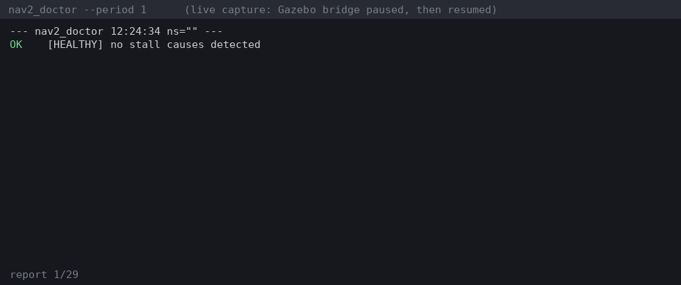

# nav2_doctor

[](https://github.com/darshmenon/nav2_doctor/actions/workflows/ci.yml)
[](https://docs.ros.org/)
[](LICENSE)

**Why isn't my robot moving?** Attach to a running Nav2 stack and get a one-line cause. It is read-only: it subscribes to topics and asks lifecycle nodes for their state, and never publishes or changes anything.



*Rendered from real output captured on a Gazebo maze sim: healthy, then the bridge is paused and the doctor names the dead TF edges, odom and scan, and the Nav2 nodes that never activated. Source: `docs/demo_raw.txt`, `docs/make_demo_gif.py`.*

Born in [rosnav](https://github.com/darshmenon/rosnav), a ROS 2 Nav2 stack with SLAM, frontier exploration and multi-robot fleets; rosnav ships this as `scripts/nav2_doctor.py` and tested it on its live Gazebo maze sim.

## Quick start

```bash
ros2 run nav2_doctor nav2_doctor                 # live, a report every 2 s
ros2 run nav2_doctor nav2_doctor --ns robot1     # a namespaced robot
ros2 run nav2_doctor nav2_doctor --once 5        # watch 5 s, print one report, exit 1 if any ERROR (for CI)
```

A real report, 3.5 s after the sim bridge was frozen:

```
ERROR [TF_EDGE_STALE] transform odom->base_link stopped 3.5s ago while other TF is alive
ERROR [ODOM_STALE] odometry silent for 3.5s
ERROR [SCAN_STALE] laser scan silent for 3.5s
ERROR [COSTMAP_STALE] local costmap not updating (3.8s) - usually a TF or scan problem upstream
```

## What it checks

| Code | Level | Means |
|---|---|---|
| `TF_NONE` / `TF_FREEZE` | error | no `/tf` at all, or `/tf` silent for more than 2 s |
| `TF_EDGE_STALE` | error | one transform stopped while other TF is alive (a dead publisher) |
| `NO_MAP_ODOM` | warn | no `map->odom`, so SLAM or AMCL isn't localising |
| `ODOM_STALE` / `SCAN_STALE` | error | odometry or laser scan went silent (`*_NONE` warns when never seen) |
| `COSTMAP_STALE` | error | the local costmap stopped updating |
| `NODE_INACTIVE` | error | a Nav2 server is not `active` after the startup grace (60 s, `--startup-grace`) |
| `NODE_STARTING` / `NODE_MISSING` | warn | still inside the grace period, or the lifecycle service is not there |
| `GOAL_FLAPPING` | warn | 4 or more goals cancelled or aborted within 30 s (an oscillating goal source) |
| `AMCL_UNCERTAIN` | warn | `/amcl_pose` covariance above 0.5 m^2, so the robot is poorly localised |
| `NO_PROGRESS` | warn | a goal is active but odometry shows the robot hasn't moved (15 s, 0.1 m by default) |
| `CMD_ZERO` / `NO_CMD_VEL` | error | a goal is active but `cmd_vel` is zero or absent |

Checked servers: `controller_server`, `planner_server`, `bt_navigator`, `behavior_server`, `smoother_server`, `waypoint_follower`. Verified on Humble against a live Gazebo sim (a frozen bridge is caught within about 3 s and clears on recovery) and in CI on Humble and Jazzy against a fake Nav2 graph.

## Why

When Nav2 sits still, finding the cause means juggling `ros2 topic hz`, `tf2_echo`, `ros2 lifecycle get` and the logs. nav2_doctor runs those checks together. Pair it with [nav2_fault_inject](https://github.com/darshmenon/nav2_fault_inject) to break a stack on purpose and watch the doctor name the cause.

## Limits

- Thresholds are tunable with `--stale`, `--flap-count`, `--flap-window`, `--progress-time`, `--progress-dist`.
- The costmap check needs `/local_costmap/costmap`; the goal checks need `navigate_to_pose`.
- One robot per run; use `--ns` once per robot.
- Reports to the terminal (text or `--json`); no `/diagnostics` output yet.

## Roadmap

- a `/diagnostics` publisher
- repeating recovery behaviours; AMCL covariance too high
- inert costmap filters and a map-distortion check (`map->odom` yaw ramp)
- multi-robot auto-discovery; ERROR lines from `/rosout` tied to the cause
- PyPI release and a live Jazzy test

Build: `colcon build --packages-select nav2_doctor`. Tests: `python3 -m pytest test` (unit tests need no ROS; the integration tests run the real CLI against a fake Nav2 graph when ROS 2 is sourced).
