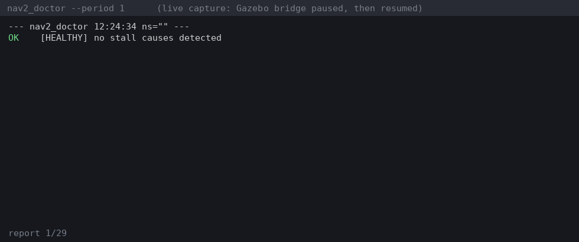
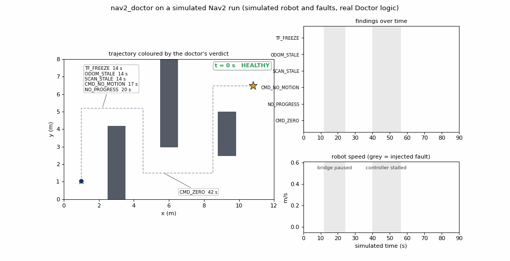
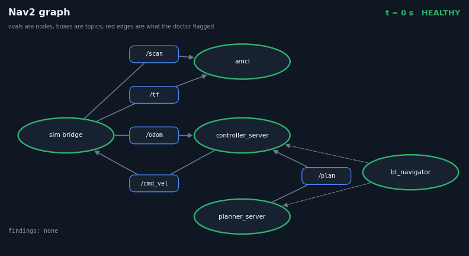

# nav2_doctor

[](https://github.com/darshmenon/nav2_doctor/actions/workflows/ci.yml)
[](https://docs.ros.org/)
[](LICENSE)

**Why isn't my robot moving?** Attach to a running Nav2 stack and get a one-line cause. It is read-only: it subscribes to topics and asks lifecycle nodes for their state, and never publishes or changes anything.



*Rendered from real output captured on a Gazebo maze sim: healthy, then the bridge is paused and the doctor names the dead TF edges, odom and scan, and the Nav2 nodes that never activated. Source: `docs/demo_raw.txt`, `docs/make_demo_gif.py`.*

Born in [rosnav](https://github.com/darshmenon/rosnav), a ROS 2 Nav2 stack with SLAM, frontier exploration and multi-robot fleets; rosnav ships this as `scripts/nav2_doctor.py` and tested it on its live Gazebo maze sim.

## Install

nav2_doctor needs a ROS 2 environment (Humble or Jazzy): `rclpy` comes from the ROS install, not from PyPI. Source ROS first (`source /opt/ros/<distro>/setup.bash`), then either build it in a colcon workspace (below) or, once published, `pip install nav2-doctor` into that same environment. Without ROS the command prints a short message and exits with code 2.

## Quick start

```bash
ros2 run nav2_doctor nav2_doctor                 # live, a report every 2 s
ros2 run nav2_doctor nav2_doctor --ns robot1     # a namespaced robot
ros2 run nav2_doctor nav2_doctor --once 5        # watch 5 s, print one report, exit 1 if any ERROR (for CI)
ros2 run nav2_doctor nav2_doctor --ready            # pre-flight: hints + READY / NOT READY verdict, exit 1 if not ready
```

A real report, 3.5 s after the sim bridge was frozen:

```
ERROR [TF_EDGE_STALE] transform odom->base_link stopped 3.5s ago while other TF is alive
ERROR [ODOM_STALE] odometry silent for 3.5s
ERROR [SCAN_STALE] laser scan silent for 3.5s
ERROR [COSTMAP_STALE] local costmap not updating (3.8s) - usually a TF or scan problem upstream
```

## What it checks

| Code | Level | Means |
|---|---|---|
| `TF_NONE` / `TF_FREEZE` | error | no `/tf` at all, or `/tf` silent for more than 2 s |
| `TF_EDGE_STALE` | error | one transform stopped while other TF is alive (a dead publisher) |
| `CLOCK_STALLED` | error | `/clock` was publishing and has gone silent (simulator paused or its bridge stopped) |
| `NO_MAP_ODOM` | warn | no `map->odom`, so SLAM or AMCL isn't localising |
| `ODOM_STALE` / `SCAN_STALE` | error | odometry or laser scan went silent (`*_NONE` warns when never seen) |
| `COSTMAP_STALE` | error | the local costmap stopped updating |
| `NODE_INACTIVE` | error | a Nav2 server is not `active` after the startup grace (60 s, `--startup-grace`) |
| `NODE_STARTING` / `NODE_MISSING` | warn | still inside the grace period, or the lifecycle service is not there |
| `GOAL_FLAPPING` | warn | 4 or more goals cancelled or aborted within 30 s (an oscillating goal source) |
| `AMCL_UNCERTAIN` | warn | `/amcl_pose` covariance above 0.5 m^2, so the robot is poorly localised |
| `NO_PROGRESS` | warn | a goal is active but odometry shows the robot hasn't moved (15 s, 0.1 m by default) |
| `RATE_DROP` / `RATE_SPIKE` | warn | with `--baseline`: a stream runs below half or above double the rate learned by `--learn` |
| `FILTER_BAD_LIMIT` / `FILTER_MOSTLY_SLOW` | warn | a speed mask has cells Nav2 reads as no limit, or half of it is below 25% speed (often an inverted mask) |
| `SPEED_LIMIT_UNHEARD` | warn | a speed limit is published on a topic `controller_server` does not subscribe to, so speed zones have no effect |
| `FILTER_BELOW_MIN_SPEED` | warn | a speed mask can limit DWB's max speed under its minimum speed, so motions (or all samples) are rejected |
| `CMD_ZERO` / `NO_CMD_VEL` | error | a goal is active but `cmd_vel` is zero or absent |

Checked servers: `controller_server`, `planner_server`, `bt_navigator`, `behavior_server`, `smoother_server`, `waypoint_follower`. Verified on Humble against a live Gazebo sim (a frozen bridge is caught within about 3 s and clears on recovery) and in CI on Humble and Jazzy against a fake Nav2 graph.

## Simulation



A matplotlib replay of a robot driving a planned path while two faults are injected: a paused bridge (TF, odom and scan stop, 12 to 24 s) and a stalled controller (`cmd_vel` is zero, 40 to 56 s). The trail is coloured by the doctor's verdict at each moment, and the timeline shows which finding fires when. The robot, obstacles and faults are simulated; the verdicts come from the real `Doctor` class (here with `--progress-time 8` so the run stays short). Regenerate with `python3 docs/nav_sim.py` (needs matplotlib and pillow).

### What the doctor sees



The same run as a graph: ovals are nodes, boxes are topics, and an edge turns red when a finding covers it (`/scan`, `/tf` and `/odom` for a frozen bridge, `/cmd_vel` for a zero command). The layout is hand-placed for clarity, not read from a live `ros2 node list`.

## Per-robot baselines

Fixed thresholds do not fit every robot: a 5 Hz lidar is healthy on one machine and broken on another. Record what normal looks like once, then get warned when a stream drifts from it:

```bash
nav2_doctor --expect scan:10 --expect odom:20             # no learning: state the normal rate, flag drops/spikes
nav2_doctor --learn 60 --baseline-file my_robot.json      # on a healthy robot: writes the normal rate of each stream
nav2_doctor --baseline --baseline-file my_robot.json      # later: RATE_DROP / RATE_SPIKE when a stream is below half or above double normal
```

The rate is the median messages per second (so bursts and a few stalls do not skew it); there is no model and no training data, and each finding states the learned number it is compared with. A silent stream is still reported by the stale checks, not here. Re-learn after you change a driver or a bridge setting on purpose.

## Fault-injection scoreboard

Measured with [nav2_fault_inject](https://github.com/darshmenon/nav2_fault_inject): one headless single-robot maze sim, nine injected pauses (`parameter_bridge` for `SCAN_STALE`, `controller_server` for `NO_CMD_VEL`, `slam_toolbox` for `TF_EDGE_STALE`, three each), a finding must appear within 10 s.

| run | doctor | detected |
|---|---|---|
| 1 | before any fix (6 s controller pause, longer than Nav2's 4 s bond timeout, so not comparable) | 6/9 |
| 2 | after the `CMD_ZERO` vs `NO_CMD_VEL` fix | 6/9 (all three `NO_CMD_VEL` missed) |
| 4 | after also watching `/cmd_vel_nav` | 9/9 |

The run 2 misses were measured: a 3 s `controller_server` pause leaves `/cmd_vel` silent for only 1.25 to 1.75 s (the velocity smoother keeps repeating), under the 2.0 s threshold, while `/cmd_vel_nav` is silent for 2.5 to 2.75 s. Caveat: the `/cmd_vel_nav` fix was tuned on data from this same scenario, so 9/9 is not a fresh benchmark. 
**Held-out run (2026-11-23, cafe world, other pause lengths, two new targets, nothing tuned on it): 7/9.** `slam_toolbox` and `parameter_bridge` 4/4, `velocity_smoother` and `ekf_filter_node` 3/3, the 2.5 s `controller_server` pauses 0/2. The 200 s no-fault control before it gave no errors or warnings in 199 reports (a small sample).

Since then the controller check expects `/cmd_vel_nav` only while the behaviour tree says `FollowPath` is running, because recovery behaviours publish straight to `/cmd_vel` (the earlier check would have called that a hung controller), and uses a 1.0 s threshold then (2.0 s if no BT log is seen). That change is unit-tested; since it was motivated by the 7/9 misses it needs a fresh scenario before any new score is quoted.

## Why

When Nav2 sits still, finding the cause means juggling `ros2 topic hz`, `tf2_echo`, `ros2 lifecycle get` and the logs. nav2_doctor runs those checks together. Pair it with [nav2_fault_inject](https://github.com/darshmenon/nav2_fault_inject) to break a stack on purpose and watch the doctor name the cause.

## Limits

- Thresholds are tunable with `--stale`, `--flap-count`, `--flap-window`, `--progress-time`, `--progress-dist`, `--progress-yaw` (turning in place counts as movement).
- The costmap check needs `/local_costmap/costmap`; the goal checks need `navigate_to_pose`.
- One robot per run; use `--ns` once per robot.
- Reports to the terminal (text or `--json`); `--diagnostics` also publishes a `DiagnosticArray` on `/diagnostics` (`/<ns>/diagnostics` with `--ns`).

## Roadmap

- repeating recovery behaviours; AMCL covariance too high
- a map-distortion check (`map->odom` yaw ramp); inert costmap filters are done (`FILTER_NO_MASK`, `FILTER_NO_INFO`)
- multi-robot auto-discovery; ERROR lines from `/rosout` tied to the cause
- a live Jazzy test, and the first PyPI release (the workflow job is ready but off until a trusted publisher exists on pypi.org, see `.github/workflows/release.yml`)

Build: `colcon build --packages-select nav2_doctor`. Tests: `python3 -m pytest test` (unit tests need no ROS; the integration tests run the real CLI against a fake Nav2 graph when ROS 2 is sourced).
